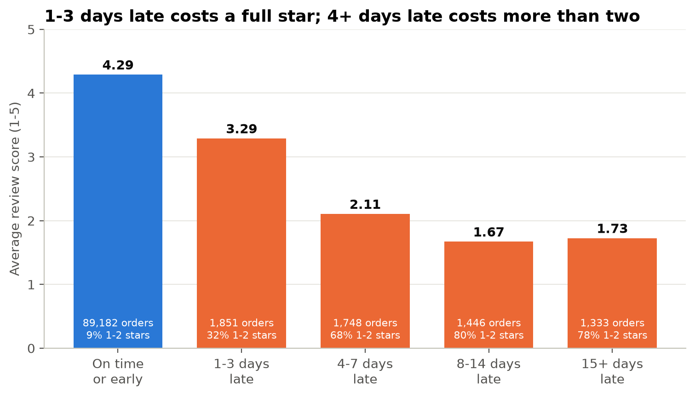
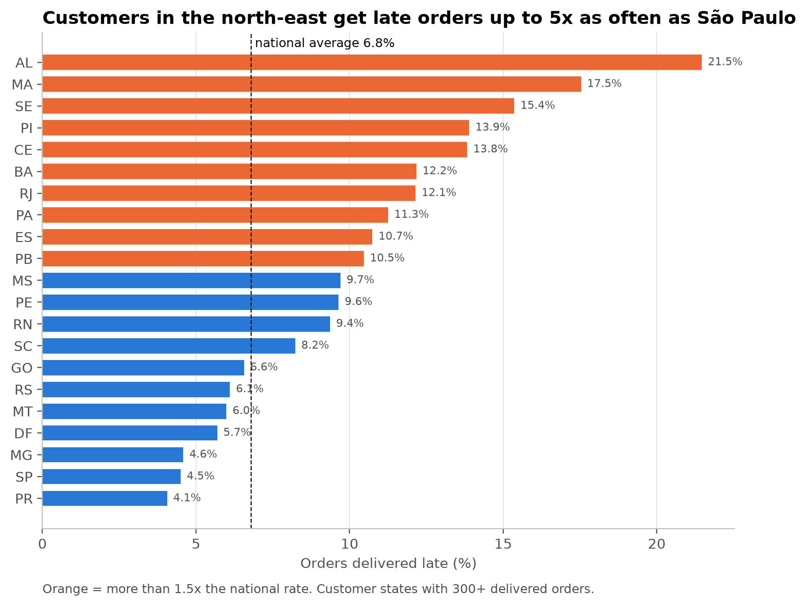
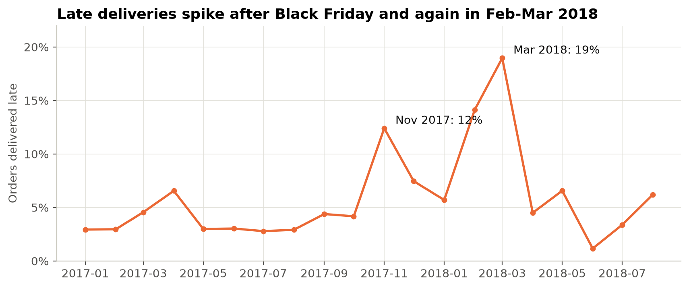

# Olist E-commerce Analysis: what drives bad reviews?

An end-to-end analysis of 96,211 delivered orders (R$15.4M) from Olist, a Brazilian online marketplace, Jan 2017 – Aug 2018. The question: what drives revenue, and what drives bad reviews? Built with SQL, Python, Excel and Power BI.

**Main finding: late delivery is the biggest driver of bad reviews.** On-time orders average 4.29 stars. Orders 4 or more days late average about 2 stars, and late orders are only 6.7% of reviewed orders but cause 32.6% of all 1–2 star reviews.



## Key findings

1. **Late delivery drives bad reviews.** One to three days late drops the average review from 4.29 to 3.29 stars. Four or more days late drops it to about 2, and 68–80% of those customers leave 1 or 2 stars.
2. **Lateness depends on where the customer lives.** Customers in north-east states such as Alagoas (21.5%) and Maranhão (17.5%) get late orders up to 5x as often as São Paulo (4.5%), and wait twice as long (19–25 days vs 9–12).
3. **Big promotions break the delivery network.** The late rate is normally 3–5%. It jumped to 12.4% for Black Friday 2017 orders and to 19.0% in March 2018.
4. **Orders split across sellers score 1.3 stars lower** (2.85 vs 4.17), even though only 1.0% of them are late, most likely because they arrive in separate parcels.
5. **Revenue grew 2.8x, then levelled off.** Average monthly revenue went from R$377k (Jan–Jun 2017) to R$1.06M (2018) and has stayed near R$1M a month since March 2018. Black Friday (24 Nov 2017) was the biggest day: 1,147 orders, 7.7x a normal day.
6. **Customers rarely come back.** Only 3.0% of 93,104 customers ordered more than once, and they bring in 5.6% of revenue.
7. **Revenue is concentrated.** São Paulo state brings in 37% of revenue, and 8 of 70+ categories bring in 54%.

<p>
  
  
</p>

## Recommendations

1. **Fix delivery where it is worst.** Set longer, more honest delivery estimates for north-east states, or move those routes to better carriers. Late orders cause a third of all bad reviews, so cutting them is the biggest lever on review scores.
2. **Plan logistics capacity before big promotions.** The late rate tripled after Black Friday 2017. Book extra carrier capacity and stretch delivery estimates for orders placed during promotions.
3. **Handle multi-seller orders differently.** Tell customers at checkout that their order will arrive in several parcels, or consolidate shipments. It affects only 1.3% of orders, but nearly half of them get 1–2 stars.
4. **Start a repeat-purchase programme.** With a 3% repeat rate, almost every sale must be acquired from scratch. A voucher sent after an on-time delivery targets the customers most likely to be happy.

## Data quality

26 checks were run on the raw data, and 19 found something. The full list, with row counts and how each issue was handled, is in [`data_quality_report.md`](data_quality_report.md). The ones that changed the analysis:

| Issue | Rows | How it was handled |
|---|---:|---|
| `customer_id` is new for every order, so it hides repeat customers | 3,345 | Customers counted by `customer_unique_id` |
| Sparse months at the edges (2016, Sep–Oct 2018) | 349 orders | Analysis limited to Jan 2017 – Aug 2018 |
| Orders with more than one review | 547 | Scores averaged per order first |
| Orders with no items (99% cancelled or unavailable) | 775 | Dropped from revenue |
| Products with no category, or no English name | 623 | Labelled `unknown`, or Portuguese name kept |
| Delivered orders with no delivery date | 8 | Left out of delivery metrics only |

## What is in the project

| Part | Files | Skills shown |
|---|---|---|
| **SQL** | [`sql/`](sql/): 15 queries, one business question each, plus [`schema.md`](sql/schema.md) | Joins, CTEs, window functions (`RANK`, `LAG`, running `SUM`), `CASE` buckets, data-quality checks |
| **Python** | [`01_data_quality.ipynb`](notebooks/01_data_quality.ipynb), [`02_eda.ipynb`](notebooks/02_eda.ipynb) | pandas cleaning and validation, matplotlib charts, a written interpretation under every chart |
| **Excel** | [`excel/olist_monthly_tracker.xlsx`](excel/olist_monthly_tracker.xlsx) | Excel Tables, `SUMIFS`/`COUNTIFS`/`AVERAGEIFS`, `XLOOKUP`, dropdown filters, conditional formatting, sparklines, charts |
| **Power BI** | [`dashboard/`](dashboard/): star-schema tables, [`measures.dax`](dashboard/measures.dax), [theme](dashboard/olist_theme.json), [build guide](dashboard/POWER_BI_GUIDE.md) | Star-schema modelling, DAX measures (`CALCULATE`, `DATEADD`, filter-context-aware repeat rate) |
| **Summary** | [`olist_summary.pdf`](olist_summary.pdf) | One-page summary of findings for readers who won't open the code |

The **Excel tracker** answers "how did we do last month?" in one click. Pick a month on the Summary tab to see revenue, orders, average order value, late rate and review score against the month before, with 20-month sparklines. Other tabs break the numbers down by month (filterable by state), by category × month, and by state with red/amber/green late-rate flags.

## Project structure

```
data/raw/                 Kaggle CSVs (not committed; see below)
data/clean/               Result of every SQL query, as CSV
sql/                      15 queries + schema.md (tables, joins, rules every query follows)
notebooks/                01 data quality, 02 exploratory analysis
images/                   Charts used in this README and the notebooks
excel/                    Monthly tracker workbook
dashboard/                Power BI tables, DAX measures, theme and build guide
load_data.py              Builds olist.db (SQLite) from the raw CSVs
run_queries.py            Runs every query in sql/ and saves results to data/clean/
build_excel.py            Builds the Excel tracker
build_powerbi_data.py     Exports the Power BI star-schema tables
build_summary_pdf.py      Builds the one-page PDF summary
data_quality_report.md    Every data issue found, its size and how it was handled
```

## How to run it

1. Download the [Brazilian E-Commerce Public Dataset by Olist](https://www.kaggle.com/datasets/olistbr/brazilian-ecommerce) from Kaggle and put the 9 CSVs in `data/raw/`.
2. Set up Python 3 and rebuild everything:

```bash
python3 -m venv .venv
source .venv/bin/activate
pip install -r requirements.txt

python load_data.py            # builds olist.db, about 6 seconds
python run_queries.py          # runs the 15 queries, saves results to data/clean/
jupyter nbconvert --to notebook --execute --inplace notebooks/*.ipynb
python build_excel.py          # excel/olist_monthly_tracker.xlsx
python build_powerbi_data.py   # dashboard/*.csv
python build_summary_pdf.py    # olist_summary.pdf
```

## Rules behind every number

- **Revenue** = item price + freight, delivered orders only.
- **Period** = orders purchased Jan 2017 – Aug 2018 (20 full months).
- **Late** = delivered on a later calendar day than the estimate shown at checkout.
- **Customers** are counted by `customer_unique_id`, never `customer_id`.

## Dataset and credit

[Brazilian E-Commerce Public Dataset by Olist](https://www.kaggle.com/datasets/olistbr/brazilian-ecommerce), released by Olist on Kaggle under CC BY-NC-SA 4.0.
